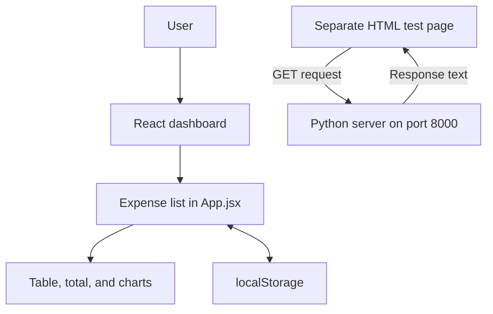

# Expense Tracker

I am in Grade 12 and am working on this project to sharpen my coding skills for college. I plan to study a Bachelor of Science in Computer Science, and this project gave me a way to apply what I was learning to a working app.

The app lets users keep track of expenses, filter their spending, and see the results in charts. The project also includes a Python server and a separate page for trying out requests to the backend.

## How I built it

I wrote the application code myself through hands-on practice without AI help. I used AI to help edit these README files.

## Tools I used

| Part | Tools | What it does |
| --- | --- | --- |
| Frontend | React, JavaScript, Vite | Displays the dashboard and handles user actions |
| Styling | Tailwind CSS | Styles the forms, table, and page layout |
| Charts | Chart.js, react-chartjs-2 | Shows spending by category and date |
| Browser storage | localStorage | Keeps expenses after refreshing the page |
| Backend server | Python `http.server` | Responds to requests on `localhost:8000` |
| Database | PostgreSQL | My backend database; the connection code and table setup are not included in this repository yet |
| Code checks | ESLint | Checks the frontend JavaScript and React code |

## How the parts fit together

Right now, the expense dashboard saves its data in the browser. The Python server example runs separately. The React app does not send expenses to the server yet.



I use PostgreSQL for the backend database. This repository has a note with the PostgreSQL 17 installation path, but it does not include the database connection or SQL files yet. That means someone downloading this version can run the dashboard and server example, but cannot recreate my database setup from these files alone.

## Project folders

```text
full_stack_application/
├── README.md
├── frontend/
│   ├── README.md
│   ├── package.json
│   ├── vite.config.js
│   ├── eslint.config.js
│   ├── index.html
│   ├── public/
│   └── src/
│       ├── main.jsx
│       ├── App.jsx
│       ├── index.css
│       ├── data/dummyData.js
│       └── components/
│           ├── Header.jsx
│           ├── ExpenseForm.jsx
│           ├── Filters.jsx
│           ├── ExpensesTable.jsx
│           └── ChartsSection.jsx
├── python-server-project/
│   ├── main.py
│   └── index.html
└── CProgram FilesPostgreSQL17bin.txt
```

## Frontend

Users can add an expense with a description, amount, date, and category. The categories are Bills, Food, and Fun. They can also edit an expense or delete it after confirming the action.

The dashboard has category and date filters. The table, total, and charts all use the filtered expenses, so they update together. The pie chart shows spending by category, and the bar chart shows spending by date.

Most of the logic is in `App.jsx`. I split the interface into smaller components for the header, form, filters, table, and charts. `App.jsx` passes data and functions to those components through props.

### Expense logic

- **Adding:** Check that the description, amount, and date are filled in, convert the amount with `parseFloat`, give the expense a `Date.now()` ID, and add it to the start of the list.
- **Editing:** Use `map` to update the expense with the matching ID.
- **Deleting:** Use `filter` to remove the expense with the matching ID.
- **Filtering:** Check the category and compare dates written as `YYYY-MM-DD`. The start and end dates are included.
- **Calculating:** Use `reduce` to add up the amounts and group them for the charts.
- **Saving:** Read saved expenses from `localStorage` when the app starts and use `useEffect` to save changes as JSON. If there is no saved list, load four sample expenses.

There is more detail in the [frontend README](frontend/README.md).

## Backend and server

The server code is in `python-server-project/main.py`. It uses Python's built-in `HTTPServer` and `BaseHTTPRequestHandler`, so this example does not need extra Python packages.

The server runs at `http://localhost:8000`. When it receives a GET request, it returns status `200` and the message `Hello from the python backend`. It also sends an `Access-Control-Allow-Origin: *` header so the separate test page can read the response from another origin.

The test page is `python-server-project/index.html`. Clicking **Get Results** runs `fetch`, waits for the response, reads it as text, and displays it on the page. This is the part of the project that shows a browser communicating with a server. The current Python file does not have expense routes or database queries.

## Database

PostgreSQL is the database I use for the backend. The file `CProgram FilesPostgreSQL17bin.txt` contains the path `C:\Program Files\PostgreSQL\17\bin` from my Windows setup.

I still need to include the database setup in this repository and connect the expense dashboard to it. The expense records already have an ID, description, amount, date, and category, which gives me a starting point for a database table. For money, a PostgreSQL `NUMERIC` column would avoid the rounding issues that can happen with floating-point numbers.

## Running the project

### Frontend

You need Node.js and npm that support the Vite version in `frontend/package.json`. Starting from the project root, run:

```powershell
cd frontend
npm install
npm run dev
```

Open the local address shown in the terminal. The dashboard works without starting Python or PostgreSQL because this version saves expenses in the browser.

Other frontend commands:

| Command | What it does |
| --- | --- |
| `npm run build` | Creates the production files in `dist/` |
| `npm run preview` | Lets you preview the app after building it |
| `npm run lint` | Checks the JavaScript and JSX code |

### Python server

You need Python 3. Open another terminal at the project root and run:

```powershell
cd python-server-project
python main.py
```

Open `python-server-project/index.html` in a browser and click **Get Results**. You can also visit `http://localhost:8000` directly to see the message. Press `Ctrl+C` in the terminal to stop the server.

## Things to try

1. Add an expense and check that it appears in the table.
2. Edit it with **Save Changes**, then check the updated amount.
3. Filter by category or date and watch the total and charts change.
4. Refresh the page to check that the expenses are still saved.
5. Delete an expense and confirm the action.
6. Start the Python server and try the **Get Results** button on the separate test page.

## What this project helped me practice

Working on this app gave me practice with React state, forms, props, and event handlers. I also used JavaScript arrays and objects to store records, update them, and calculate totals. The charts made those calculations visible on the page.

The Python example gave me a way to work with HTTP requests and responses. These are topics I want to keep studying in computer science, along with databases, algorithms, and software development.

## What I want to improve

- Connect the React app to Python expense routes and PostgreSQL.
- Add the database schema and setup instructions to the repository.
- Improve amount validation and handle invalid saved data.
- Sort the dates on the bar chart.
- Fix the edit form's Cancel button so it cannot submit the form.
- Improve keyboard support for the edit window.
- Add tests for adding, editing, deleting, filtering, and saving expenses.

The app currently has basic validation and browser-only storage. It does not have user accounts or an automated test suite yet.
