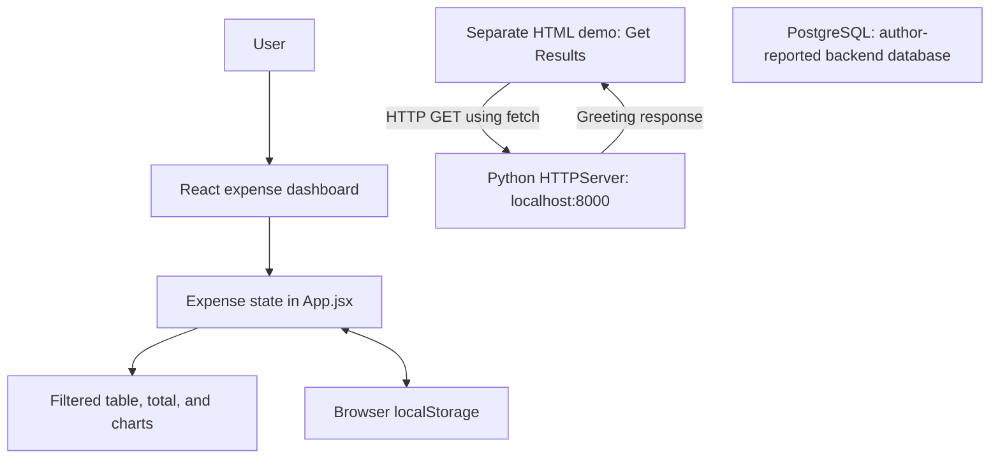

# Expense Tracker — Grade 12 Computer Science Portfolio

An expense-tracking project developed in Grade 12 for my college application portfolio toward a Bachelor of Science in Computer Science. The project combines a React spending dashboard with a separate Python HTTP server demonstration and PostgreSQL as the author's backend database.

The dashboard supports expense management, filtering, summaries, and charts. The repository also includes an early client/server exercise, showing the current development stage through readable source code.

## Authorship and learning approach

I created the application code through hands-on programming without AI help. My approach was to practice implementing application behavior directly: managing state, handling input, transforming records, and experimenting with browser-to-server communication. AI assisted with this README and the frontend README update; the statement about working without AI applies to the application code.

This portfolio documents implemented behavior and current boundaries. It provides concrete examples of programming concepts that form a foundation for undergraduate computer science.

## Architecture

| Layer | Technology | Current role |
| --- | --- | --- |
| Frontend | React 19, JavaScript, Vite 8 | Expense dashboard and application state |
| Styling | Tailwind CSS 4 | Responsive layout, forms, table, and dark theme |
| Visualization | Chart.js 4, react-chartjs-2 | Category pie chart and totals by date |
| Frontend persistence | Browser `localStorage` | Saves the expense list as JSON |
| Backend/server | Python `http.server` | Separate local HTTP demonstration on port 8000 |
| Database | PostgreSQL | Backend database identified by the author; connection code and schema are not included in this checkout |
| Development checks | ESLint | JavaScript and React lint configuration |



The two browser interfaces are separate. React does not currently call the Python server. PostgreSQL is part of the author's backend setup, but no database connection, schema, migration, or query is present in the checked-in source. The root text file records a PostgreSQL 17 binary directory on Windows; it is a setup note, not a database configuration.

## Repository organization

```text
full_stack_application/
├── README.md
├── frontend/
│   ├── README.md
│   ├── package.json
│   ├── vite.config.js
│   ├── eslint.config.js
│   ├── index.html
│   ├── public/
│   └── src/
│       ├── main.jsx
│       ├── App.jsx
│       ├── index.css
│       ├── data/dummyData.js
│       └── components/
│           ├── Header.jsx
│           ├── ExpenseForm.jsx
│           ├── Filters.jsx
│           ├── ExpensesTable.jsx
│           └── ChartsSection.jsx
├── python-server-project/
│   ├── main.py
│   └── index.html
└── CProgram FilesPostgreSQL17bin.txt
```

## Frontend and application logic

Users can create, read, update, and delete expenses with a description, numeric amount, date, and category. Categories are Bills, Food, and Fun. Deletion asks for confirmation; updates use an edit modal. Short notifications provide feedback after changes.

`App.jsx` owns shared state and supplies values and event handlers to smaller components. Controlled inputs update form state using their `name` and `value` properties. Creating an expense checks for required values, converts the amount with `parseFloat`, assigns a timestamp ID, and inserts the record at the beginning of the list. Editing uses `map` to replace a matching record; deletion uses `filter` to remove it.

Category and inclusive date filters produce one derived expense list. The table reads that list, while `reduce` computes its total and grouped amounts for both charts. Changing a filter therefore updates the records, total, and visualizations together. Dates use `YYYY-MM-DD` strings; chart labels are not explicitly sorted.

Expenses initialize from JSON in `localStorage`, falling back to four sample records. An effect saves later changes. This persistence belongs to the browser and is independent of PostgreSQL. Component details are documented in the [frontend README](frontend/README.md).

## Backend and HTTP server

`python-server-project/main.py` uses Python's standard-library `BaseHTTPRequestHandler` and `HTTPServer`. It binds to `localhost:8000` and runs `serve_forever()`.

The `do_GET` handler returns status `200`, an `Access-Control-Allow-Origin: *` header, a `Content-Type: Text/html` header, and the body `Hello from the python backend`. It responds to GET requests without route-specific logic. Expense endpoints and database operations are not implemented in this file.

The neighboring `index.html` demonstrates the client side of the exchange. Clicking **Get Results** calls `fetch('http://localhost:8000')`, awaits the response, reads it as text, and inserts it into the page with `textContent`. These files demonstrate HTTP request/response flow, asynchronous JavaScript, response headers, and DOM updates.

## PostgreSQL database

The author identifies PostgreSQL as the backend database. The repository includes a setup note pointing to `C:\Program Files\PostgreSQL\17\bin`. The database setup cannot be reproduced from this checkout because connection settings, schema, and SQL operations are absent.

For a future repository-complete integration, the expense fields—ID, description, amount, date, and category—can form a relational table. A PostgreSQL `NUMERIC` column would support exact decimal amounts. A Python API would validate incoming records, execute parameterized queries, and return JSON to React. This describes the next integration step, not an existing schema or implemented API.

## Run locally

### Expense dashboard

Install Node.js and npm compatible with the Vite dependency in `frontend/package.json`. From the repository root:

```powershell
cd frontend
npm install
npm run dev
```

Open the URL printed by Vite. The current dashboard does not require Python or PostgreSQL because its records are stored in the browser.

### Python HTTP demonstration

With Python 3 installed, open another terminal at the repository root:

```powershell
cd python-server-project
python main.py
```

Open `python-server-project/index.html` in a browser and click **Get Results**, or visit `http://localhost:8000` directly. Stop the server with `Ctrl+C`. This demonstration uses only the Python standard library and does not connect to PostgreSQL in the provided code.

## Review walkthrough

1. Launch the dashboard and inspect the sample expenses.
2. Add an expense, edit it using **Save Changes**, and confirm deletion of a record.
3. Apply category or date filters and observe the table, total, and charts update together.
4. Reload the page to check browser persistence.
5. Run the Python server and use **Get Results** in its separate HTML page to observe an HTTP response.

The frontend also provides `npm run build`, `npm run preview`, and `npm run lint`. These are available review commands; this documentation does not claim they pass or that an automated test suite exists.

## Computer science skills demonstrated

| Concept | Evidence in the code |
| --- | --- |
| Decomposition and interfaces | UI components receive props and callbacks from `App.jsx` |
| State and event-driven programming | React hooks, controlled inputs, and event handlers |
| Data structures and algorithms | Arrays of expense objects processed with `map`, `filter`, and `reduce` |
| Persistence and serialization | JSON reads/writes through `localStorage` |
| Data visualization | Grouped totals become pie and bar chart datasets |
| Client/server communication | Browser `fetch` calls a Python HTTP handler |
| Development tooling | Vite configuration, npm scripts, and ESLint configuration |

These examples give an admissions reviewer specific code to examine and provide a foundation for studying algorithms, databases, networks, and software engineering in a BS CS program.

## Current limits and development goals

The React and Python portions are not yet integrated in the checked-in code, and PostgreSQL integration is not represented in the source. There is no authentication or shared-user storage. Frontend validation is basic, malformed saved JSON is not handled, amounts use floating-point arithmetic, and chart dates are not explicitly sorted. The edit modal's Cancel button also needs an explicit non-submit type.

Further work can connect React to expense API endpoints, include the PostgreSQL schema and reproducible setup, improve validation and error handling, refine modal accessibility, and add tests for CRUD, filtering, and persistence. These goals extend the existing hands-on work into a complete database-backed application.
